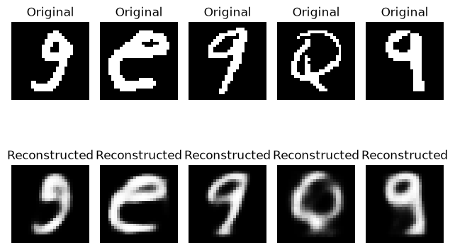
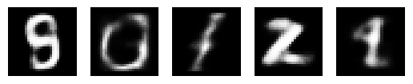
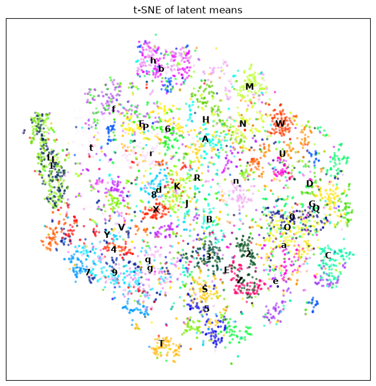
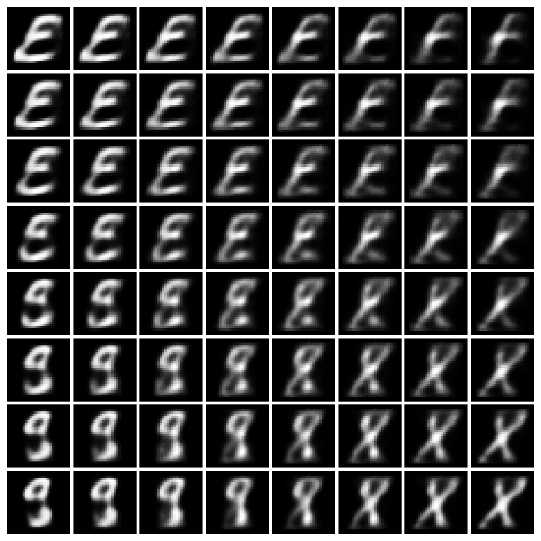

# VAE Implementation with NumPy

This repository implements a minimal MLP VAE without any ML frameworks for the model or training. Instead, a Tensor class is defined which uses NumPy arrays and a hand-implemented library of operations for backpropagation, the implementation of which is broadly based on [micrograd](https://github.com/karpathy/micrograd).

The model is trained on the EMNIST dataset, and results can be replicated by running [demo.ipynb](demo.ipynb) or [train.py](train.py). First, install the required packages:

```bash
pip install numpy torchvision matplotlib tqdm scikit-learn
```

## Results
Below are some samples showing the trained model's outputs. The hyperparameters used are included below. 

| Parameter | Value |
|---|---|
| Input size | 784 (28 × 28, binarized at 0.5) |
| Hidden size | 128 |
| Latent size | 64 |
| Training set size | 112,800 (EMNIST balanced) |
| Batch size | 64 |
| Epochs | 8 |
| KL weight (β) | 3 |
| Reconstruction loss | Binary cross-entropy (summed) |
| Optimizer | Adam |
| Learning rate | 1e-3 |
| β₁ | 0.9 |
| β₂ | 0.999 |
| ε | 1e-8 |

First, we can observe some examples of reconstruction on the test dataset.



While there is noticeable blurriness, the reconstructed images are clearly recognizable. Beyond reconstruction, however, the VAE can also be used to generate original images. A batch of these generated images is shown below; while not perfect, the samples do form recognizable characters.



We can also observe what the model has learned by visualizing the latent space with t-SNE. With a KL weight of 3, the model is encouraged to keep representations compact, but we do see clear clustering of characters, and we can also note that similar characters often appear right next to each other, such as [L, 1, I].



Finally, we can take advantage of the latent space to do interpolation between samples. Here we pick 4 images from the test set to form the corners, then interpolate between them in the latent space and decode each sample.



## Implementation

### Model Architecture ([utils/layers.py](utils/layers.py))

### Autograd ([utils/tensor.py](utils/tensor.py))

### Optimizers ([utils/optim.py](utils/optim.py))

### Losses ([utils/losses.py](utils/losses.py))